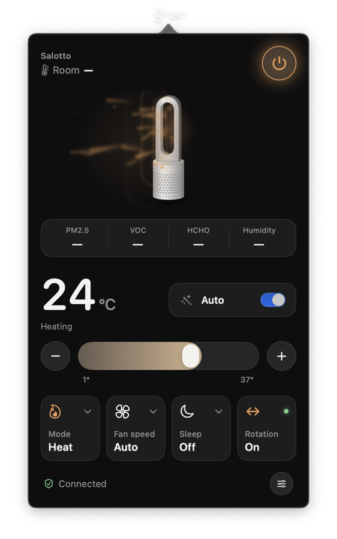

# DysonBar

A small native macOS menu-bar app to control a Dyson purifier / heater:
power, heat target, fan speed, oscillation, auto and night mode, sleep timer,
live air-quality readings and filter life, one click away.

> **Unofficial.** Not affiliated with, endorsed or supported by Dyson Ltd.
> "Dyson" and "MyDyson" are trademarks of Dyson Ltd. DysonBar talks to the
> same cloud service the MyDyson app uses, through an undocumented API that
> may change or stop working at any time. Use at your own risk.




## Features

- Menu bar: device icon plus live room temperature (or `Off`)
- Left click opens the control panel, light or dark with the system:
  - an illustrated tower with an animated airflow plume: warm while heating,
    cool otherwise, faster with fan speed, swaying while it rotates
  - room temperature, power button, air-quality strip (PM2.5, VOC,
    formaldehyde where supported, humidity)
  - heat target slider (0.5 °C steps, heaters only) and Auto mode
  - tiles for mode (heat/cool), fan speed, sleep timer and rotation
  - details: every sensor (PM10, NO₂, temperature…), HEPA filter life,
    night mode, continuous monitoring, front/back airflow, device code
- Right click: refresh, switch device (accounts with several), sign out, quit
- Controls respond instantly; the device's confirmation reconciles them
- Reconnects on its own after network loss and wake from sleep

Developed and tested on a Purifier Hot+Cool Formaldehyde (HP09). Other Wi-Fi
purifiers/fans that use the same cloud protocol should work; the panel hides
controls a device doesn't report (e.g. no heat row on non-heaters).

## Requirements

- macOS 14 Sonoma or later, Apple silicon
- Xcode or the Command Line Tools to build (`xcode-select --install`)
- A MyDyson account with the device already set up in the MyDyson app

## Install

```bash
git clone https://github.com/<you>/DysonBar.git
cd DysonBar
./build.sh --install      # builds build/DysonBar.app, copies it to /Applications, launches it
```

To start it at login, add it in System Settings → General → Login Items.

## First launch

The sign-in window opens automatically:

1. Enter the email of your MyDyson account and its country (ISO code, e.g. `IT`, `DE`, `GB`, `US`).
2. Dyson emails you a one-time code. Enter it together with your account password.
3. If the account has several devices, pick one. You can switch later from the right-click menu.

You stay signed in across restarts. If Dyson ends the session (the token
expires or you change your password), the sign-in window comes back by itself.

## Privacy and security

| What | Where | Notes |
|---|---|---|
| Account password | nowhere | sent once, over HTTPS, in the sign-in request |
| Session token | macOS Keychain, item "DysonBar" | removed by *Sign Out* |
| Selected device, last email/country | app preferences (`UserDefaults`) | not secret |
| Device state | memory only | |
| IoT credentials | memory only | short-lived, fetched for every connection |

DysonBar talks only to Dyson's API (`appapi.cp.dyson.com`, `.cn` for China)
and to the AWS IoT endpoint that the API returns. There is no telemetry and no
other server.

## How it works

The app signs in with the same email-code flow as the MyDyson app, reads the
device list, then gets short-lived AWS IoT credentials and holds one MQTT
connection over a secure WebSocket. Device state and sensor data stream in;
commands go out as `STATE-SET` messages. Protocol details:
[docs/PROTOCOL.md](docs/PROTOCOL.md).

```
App/Sources/
  DysonCloudAPI.swift   sign-in, device list, IoT credentials (HTTPS)
  MQTTClient.swift      minimal MQTT 3.1 client over URLSessionWebSocketTask
  DysonModel.swift      connection lifecycle, state, commands
  SessionStore.swift    Keychain storage of the session token
  LoginFlow/LoginView   sign-in window
  PopoverView, …        menu-bar UI
```

## Command-line tools

`tools/` has Python scripts for scripting and for exploring the protocol.
They keep their own sign-in, separate from the app, in `~/.dyson`
(override with `DYSON_HOME`; files are owner-only).

```bash
python3 -m pip install --user -r tools/requirements.txt
python3 tools/dyson_login.py --country IT            # sign in (email code), saves ~/.dyson
python3 tools/dyson_iot.py status                    # state + sensors via the cloud
python3 tools/dyson_iot.py set '{"fnsp":"0005"}'     # fan speed 5
python3 tools/dyson_local.py --host <device-ip> status   # try the LAN interface
```

`tools/recon/` has the probes used to map the protocol (port scan, HTTP and MQTT
probes, LAN auth matrix). Only point them at devices you own.

## Development

```bash
./build.sh                 # build/DysonBar.app
Tests/run.sh               # app tests against a fake Dyson cloud (offline)
Tests/snapshot.sh          # renders the panel in every state, light + dark, to build/snapshots/
python3 Tests/test_tools.py  # tool tests (offline)
scripts/check-secrets.sh   # scan for IPs, serials, tokens before committing
scripts/check-secrets.sh --install-hook   # run it automatically on every commit
```

The tests need no account, network or device: `Tests/fake_dyson.py` serves
the cloud API and an MQTT-over-WebSocket broker locally.

## Troubleshooting

- **macOS asks to allow DysonBar access to the keychain.** The build is
  ad-hoc signed, so every rebuild looks like a new app to the Keychain.
  Choose *Always Allow*.
- **"DysonBar can't be opened" for a downloaded build.** Unsigned builds are
  blocked by Gatekeeper. Build from source, or run
  `xattr -dr com.apple.quarantine /Applications/DysonBar.app`.
- **"Dyson is temporarily refusing sign-in requests (too many attempts)".**
  Dyson limits how many sign-in codes an account can request (sign-ins from
  the MyDyson app and other tools count too). Wait the time shown, then use the
  code you already received if it is recent; ask for a new one only if it never
  arrived (check spam). DysonBar never requests a second code on its own.
- **Diagnostics.** The app logs each API call (endpoint and HTTP status only,
  no personal data):
  `/usr/bin/log show --last 1h --predicate 'subsystem == "io.github.dysonbar"'`
- **Stays "Offline".** Check that the device is online in the MyDyson app.
  The panel shows the last error, and the app retries on its own.

## License

[MIT](LICENSE)
